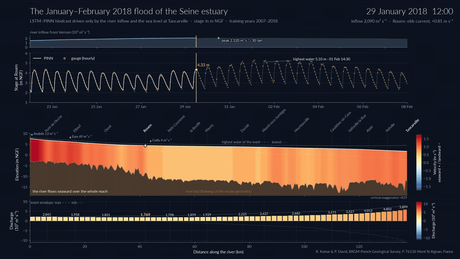

# SeinePINN_1D: Hybrid LSTM-PINN for 1-D Tidal-River Hydrodynamics

A Physics-Informed Neural Network (PINN) coupled with a Long Short-Term Memory (LSTM) network to model the water level, velocity and discharge of a tidal river with the 1-D Saint-Venant equations. The model needs only the boundary forcing (upstream discharge, downstream stage and tributaries) and gives the full field along the river at any time. It was designed for the Seine estuary (France, 137.7 km from the tidal limit to Tancarville, 2007-2025) and is tested on a synthetic estuary whose true solution is known.

This repository provides the model, the case files of the Seine and of the synthetic estuary, and the scripts for **training**, **validation and testing**, and **prediction**.



*The flood of January-February 2018, four days around the peak (29 January to 2 February), predicted from the boundary forcing alone. Top: river inflow and stage at Rouen (model and gauge). Middle: water surface along the estuary over the river bed, coloured by velocity (red seaward, blue landward). Bottom: discharge along the estuary.*

---

## Table of Contents
1. [Project Structure](#project-structure)
2. [Installation](#installation)
3. [Input Data](#input-data)
4. [Case File and Parameter Selection](#case-file-and-parameter-selection)
5. [Workflow 1: Training](#workflow-1-training)
6. [Workflow 2: Validation and Test](#workflow-2-validation-and-test)
7. [Workflow 3: Prediction](#workflow-3-prediction)
8. [The Synthetic Case](#the-synthetic-case)
9. [Outputs](#outputs)
10. [Trained Seine Model](#trained-seine-model)
11. [Citation and License](#citation-and-license)

---

## Project Structure

```text
SeinePINN_1D/
├── seinepinn_1d/               # Core Python package
│   ├── config.py               # Case file: options and their defaults
│   ├── data.py                 # Reading, aligning and gap-filling the forcing and gauges
│   ├── geometry.py             # Cross sections -> A, B, P tables -> geometry surrogate
│   ├── tides.py                # Tidal constituents and harmonic time embedding
│   ├── scales.py               # Characteristic scales from the case data
│   ├── models.py               # Hybrid LSTM-PINN network
│   ├── loss.py                 # Saint-Venant residuals and loss terms
│   ├── balance.py              # Adaptive loss weights
│   ├── engine.py               # Training, checkpoints, evaluation, prediction
│   └── utils.py                # Interpolation and skill scores
├── cases/
│   ├── seine.yaml              # Seine estuary
│   └── synthetic.yaml          # Synthetic estuary with a known solution
├── tools/
│   ├── make_synthetic_case.py  # Generates the synthetic estuary (reference solver)
│   └── raster_to_transects.py  # Cuts cross sections from a DEM along a centreline
├── data/
│   └── README.md               # Input file formats and sources (data not included)
├── models/
│   └── seine_headline.pt       # Trained Seine model
├── docs/
│   └── seine_flood_2018_peak.gif
├── tests/
│   └── test_seinepinn_1d.py
├── run_train.py                # Workflow 1: training
├── run_evaluate.py             # Workflow 2: validation and test
├── run_predict.py              # Workflow 3: prediction
├── pyproject.toml              # Package installer
├── environment.yml             # Conda environment
├── CITATION.cff
└── LICENSE
```

## Installation

1. **Clone the repository:**
   ```bash
   git clone -b SeinePINN_1D https://github.com/Ranveer82/SeinePINN.git SeinePINN_1D
   cd SeinePINN_1D
   ```

2. **Create and activate the Conda environment:**
   ```bash
   conda env create -f environment.yml
   conda activate seinepinn_1d
   ```

   (Note: the environment installs the `seinepinn_1d` package in editable mode, so changes to the source code apply at once. Without Conda: `pip install -e .`, and `pip install -e ".[geometry,test]"` for the optional parts.)

3. **Check the installation:**
   ```bash
   pytest tests/
   ```

The model runs in double precision on a GPU when one is available, otherwise on the CPU. The Seine model was trained on one GPU (a 47 GB slice of an NVIDIA H100); the synthetic case trains on a CPU.

## Input Data

The input files are **not included** in this release; their formats and sources are described in [`data/README.md`](data/README.md). A case needs:

### 1. Cross sections (`river_profiles_raster.csv`)
The shape of the river bed, one row per section.

- **X_m**: Distance downstream from the upstream boundary (m).
- **d_0 to d_N**: Transverse distance across the section (m).
- **h_0 to h_N**: Bed elevation at that point (m, survey datum).

For the Seine this file is cut from a DEM with `tools/raster_to_transects.py`.

### 2. Boundary conditions and tributaries
Used to drive the equations at the ends of the reach.

- **Upstream discharge** (`Q_in_vernon.csv`): `timestamp` and a discharge column (m3/s).
- **Downstream stage** (`boundary_downstream.csv`): `timestamp` and a stage column (m). It is imposed exactly by the network.
- **Tributaries** (`tributaries.csv`): `timestamp` and one discharge column per tributary, named in the case file.

### 3. Gauge data (`gage_stations/`)
Stage records inside the reach, used in the data loss and to score the model. One file per station, or one file for all, with:

- **timestamp**: `YYYY-MM-DD HH:MM:SS`
- **stage_m**: Water level at the gauge (m)
- **X_m**: Chainage of the gauge (m)

Gaps are allowed in every series: the model fills them and keeps a mask, so filled values never count as measurements.

## Case File and Parameter Selection

Everything about a river is in one YAML case file: paths, boundary files, tributaries, gauges, the training, validation and test periods, and the physics, training and network options. `cases/seine.yaml` is commented line by line. Any option can also be changed from the command line, e.g. `--set train.refine_steps=2000`.

The options that matter most:

| option | Seine | how to choose it |
|---|---|---|
| `datum_shift` | 4.38 | Added to all elevations so the working datum is positive. Outputs are given back in the input datum. |
| `train_start`/`end`, `val_*`, `test_*` | 2007-2018, 2019-2021, 2022-2025 | In time order and not overlapping. Use the validation period for every choice, and score the test period once at the end. |
| `gauge_step_h` | 1.0 | Keeps one reading per station per hour from sub-hourly records. |
| `physics.constituents` | auto (16) | Tidal constituents of the tidal branch. `auto` suits a meso- or macrotidal estuary. |
| `physics.manning_min`/`max`, `manning_nodes` | 0.012-0.050, 20 | Bounds and control points of the roughness n(x) (one every ~7 km here). If many control points end on a bound (see the evaluation report), check the geometry before widening the bounds. |
| `physics.geometry_smooth_m` | 2000 | Smooths the cross-section area along the channel. Survey noise in A(x) enters continuity through dA/dx; 1-2 km suits sections every 100 m. Use 0 for smooth geometry. |
| `physics.compound_channel` | true | Main channel and floodplain convey separately. Use it when the cross sections include the floodplain. |
| `model.discharge_output` | true | The network gives Q (and u = Q/A). Recommended on real rivers with irregular sections; `false` is fine on smooth geometry. |
| `train.window_days` | 30 | Length of a training window. Cover at least one spring-neap cycle (14.8 days). |
| `train.warmup_steps`, `march_steps`, `refine_steps` | 800, 500, 40000 | Training budget: warm-up + windows x march + refinement (122,300 steps for the Seine, about 4.7 h on the GPU). |
| `train.n_collocation` | 8192 | Points per step where the equations are checked. Lower it (2048-4096) on a CPU or a small GPU. |
| `--geo-steps` (run_train.py) | 10000 | Steps to fit the geometry surrogate. The log prints its errors; the top-width error (`B_rel_err`) should stay below 2-5 %. |

## Workflow 1: Training

```bash
python run_train.py cases/seine.yaml
```

For a quick test run first:
```bash
python run_train.py cases/seine.yaml --set train.march_steps=50 train.refine_steps=500
```

What this does:
1. Reads the forcing, the gauges and the cross sections, aligns everything on one hourly index and fills the gaps.
2. Builds the channel geometry (area, top width and wetted perimeter at every chainage and water level) and fits the geometry surrogate.
3. Trains the network: a short warm start on the data, a march through the training period in overlapping 30-day windows (each window starts from the state at the end of the previous one), a refinement over random windows and, if set, an L-BFGS polish.
4. Writes the model to `outputs/seine/models/model.pt` and the training history to `outputs/seine/stats/training_history.csv`.

The log prints, every 100 steps, the continuity and momentum losses, the stage error at the gauges and the error on the upstream discharge.

## Workflow 2: Validation and Test

```bash
python run_evaluate.py cases/seine.yaml --period validation
python run_evaluate.py cases/seine.yaml --period test
```

Any other period, or another model file:
```bash
python run_evaluate.py cases/seine.yaml --start 2018-01-01 --end 2018-03-01
python run_evaluate.py cases/seine.yaml --period test --checkpoint models/seine_headline.pt
```

What this does:
1. Loads the trained model (`outputs/<case>/models/model.pt`, or `--checkpoint`).
2. Scores the stage at the gauges, pooled and per station (RMSE, NSE, KGE).
3. Computes the Saint-Venant residuals on points never used in training, the volume balance of the reach and the plausibility of the fields.
4. Gives a verdict against the **admissibility gates**: continuity and momentum residuals below 0.25, volume balance below 0.25, at least 90 % of the training steps accepted, depths and velocities in the plausible range. A model that fits the stage but fails a gate does not conserve mass, and should not be used or compared with models that pass.
5. Writes `outputs/<case>/stats/<period>_report.json`.

(Note: use the validation period for every choice you make by looking at a score. Score the test period once, at the end.)

## Workflow 3: Prediction

```bash
python run_predict.py cases/seine.yaml --start 2018-01-22 --end 2018-02-08
```

With the trained Seine model and a finer grid:
```bash
python run_predict.py cases/seine.yaml --start 2018-01-22 --end 2018-02-08 \
    --checkpoint models/seine_headline.pt --dx 500 --dt-hours 0.5
```

With new forcing (another period, a scenario), in a folder with the same file formats:
```bash
python run_predict.py cases/seine.yaml --data my_forcing/ --start 2030-01-01 --end 2030-12-31
```

The hindcast 2007-2025 of the article, one file per year, every 500 m:
```bash
python run_predict.py cases/seine.yaml --start 2007-01-01 --end 2025-12-31 \
    --checkpoint models/seine_headline.pt --dx 500 --yearly
```

What this does:
1. Loads the trained model with the normalisation of its training record, so a changed forcing (e.g. a higher sea level) reaches the model as a change.
2. Encodes the forcing with the LSTM, from `--spinup-days` (default 10) before `--start`. The LSTM starts from rest and its first day is off by up to a metre; two days of spin-up are already enough. The spin-up is not written.
3. Evaluates the network on a regular grid of chainage (every `--dx` m, plus the downstream end) and time (`--dt-hours`), from `--start` to the end of the `--end` day.
4. Writes `outputs/<case>/exports/prediction_<start>_<end>.csv.gz` (or one `prediction_<year>.csv.gz` per calendar year with `--yearly`), a gzip-compressed CSV with the columns `timestamp`, `X_m`, `stage_m` (in the datum of the input files), `velocity_ms` and `discharge_m3s` (positive seaward), and `depth_m`, rounded to mm, mm/s and 0.1 m3/s.

(Note: the compressed CSV opens directly in Python, `pd.read_csv("prediction_20180122_20180208.csv.gz", parse_dates=["timestamp"])`, or after `gunzip` in any spreadsheet.)

Only the boundary forcing is needed; gauge records are optional in `--data`.

## The Synthetic Case

A 40 km funnel-shaped estuary solved with a finite-volume Saint-Venant solver. Only the stage at five gauges is used in training; the true velocity and discharge everywhere are kept to score what the model never sees.

```bash
python tools/make_synthetic_case.py --out data/synthetic
python run_train.py    cases/synthetic.yaml
python run_evaluate.py cases/synthetic.yaml --period validation
```

What this does: besides the usual report, `run_evaluate.py` finds `truth_grid.npz` in the data folder and also scores the full stage, velocity and discharge fields, the M2 amplitude along the reach and the recovered roughness against the truth (`outputs/synthetic/stats/validation_truth_report.json`).

Scenarios for the synthetic case: `--sea-level-shift 1.0` raises the sea level by 1 m, `--q-scale 2.0` doubles the river inflow.

## Outputs

```text
outputs/<case>/
├── models/
│   └── model.pt                     # trained model, with its scales and normalisations
├── stats/
│   ├── config.json                  # full configuration of the training run
│   ├── training_history.csv         # losses, loss weights and diagnostics
│   ├── validation_report.json       # skill, residuals, volume balance, verdict
│   ├── test_report.json
│   └── validation_truth_report.json # synthetic case: scores against the truth
└── exports/
    └── prediction_<start>_<end>.csv.gz # stage, velocity, discharge on a grid (or prediction_<year>.csv.gz)
```

## Trained Seine Model

`models/seine_headline.pt` is the Seine model of the article, trained with `cases/seine.yaml` on 2007-2018. Over the test period 2022-2025, scored at the 14 gauges listed in [`data/README.md`](data/README.md):

| | stage RMSE | NSE | KGE | continuity residual | momentum residual | volume balance | admissible |
|---|---|---|---|---|---|---|---|
| test 2022-2025 | 0.092 m | 0.9954 | 0.974 | 0.107 | 0.135 | 0.176 | yes |

To reproduce it (the Seine input data in `data/seine/`):
```bash
python run_evaluate.py cases/seine.yaml --period test --checkpoint models/seine_headline.pt
```

## Citation and License

If you use this code, please cite it with the information in [`CITATION.cff`](CITATION.cff). The article describing the model is in preparation; its reference will be added here.

Released under the MIT License (see [`LICENSE`](LICENSE)).

**Authors:** Ranveer Kumar and Pierre-Yann David, BRGM-French Geological Survey, F-76130 Mont St Aignan, France.
